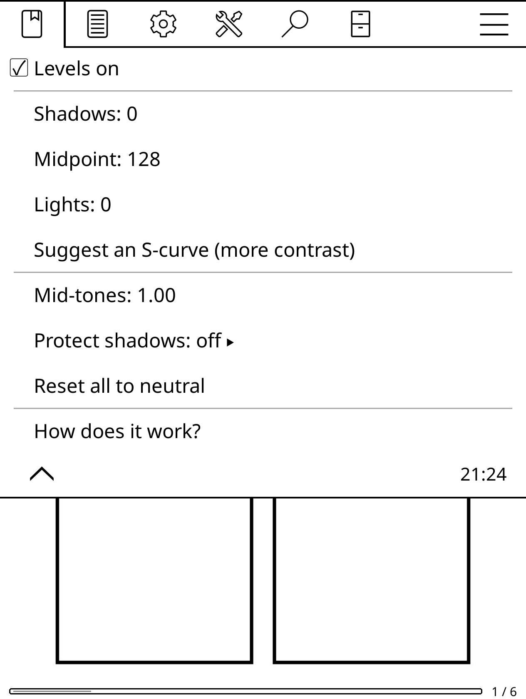

# Tonwerte (Levels) für KOReader

*English: [README.md](README.md)*

Ein KOReader-Plugin mit einer eigenen Tonwertkurve für Comics, wie in einer Bildbearbeitung. Schwarz bleibt Schwarz, Weiß bleibt Weiß. Dazwischen lässt sich ein Mittelpunkt verschieben, und Schatten und Lichter lassen sich getrennt heller oder dunkler machen, zum Beispiel für eine S-Kurve mit mehr Kontrast.

- Gedacht für Farb- und Graustufenseiten von Comics. Beides wird umgerechnet.
- Es ändert keine KOReader-Dateien und übersteht daher Updates.
- Es arbeitet mit [Comic Panel Zoom](https://github.com/Akrota/koreader-comic-panel-zoom) zusammen: Das Plugin lässt den Aufruf zum Zeichnen der Seite in der Form, die Panel Zoom erwartet.

**Stand: Prototyp / Beta.** Es läuft auf einem Kobo Libra Colour, die Einstellungen werden aber noch abgestimmt.

## Bildschirmfotos

 

## Funktionen

- **Mittelpunkt** (30 bis 225, Standard 128): trennt Schatten und Lichter. Der Mittelpunkt selbst behält seine Helligkeit.
- **Schatten** (-100 bis +100): hebt die Töne zwischen Schwarz und Mittelpunkt an (über 0) oder senkt sie ab (unter 0).
- **Lichter** (-100 bis +100): hebt die Töne zwischen Mittelpunkt und Weiß an oder senkt sie ab.
- **S-Kurve vorschlagen (mehr Kontrast):** ein Tipp stellt Schatten -30, Lichter +30 und Mittelpunkt 128 ein.
- **Mitteltöne** (0,5 bis 1,6, Standard 1,0): hebt oder senkt alles dazwischen gleichmäßig (unter 1,0 dunkler).
- **Schatten schützen** (aus / leicht / stark): die dunkelsten Töne laufen nicht zu.
- **An/Aus-Schalter** und eine **Geste** „Tonwerte an/aus“ zum schnellen Vergleichen.
- **Alles auf neutral.**
- Die Einstellungen gelten für alle Comics gleich (nicht pro Comic), damit die Seiten nicht unterschiedlich aussehen.

## Installation

1. Das ZIP unter [Releases](../../releases) herunterladen und entpacken, oder dieses Repository herunterladen.
2. Den Ordner **`tonwerte.koplugin`** in KOReaders Ordner `plugins` kopieren. Auf einem Kobo ist das `.adds/koreader/plugins/`.
3. KOReader neu starten.

## Einstellungen

Einen Comic öffnen, dann: oberes Menü → Werkzeug-Symbol → **Tonwerte** (in einem englischen KOReader: **Levels**).

- **Tonwerte an** (Hauptschalter; aus = Seiten wie ohne Plugin, die Werte bleiben)
- **Schatten**
- **Mittelpunkt**
- **Lichter**
- **S-Kurve vorschlagen (mehr Kontrast)**
- **Mitteltöne**
- **Schatten schützen** (aus, leicht, stark)
- **Alles auf neutral**
- **Wie funktioniert das?** (kurze Erklärung)

Langes Drücken auf einen Eintrag zeigt seinen Hilfetext. Für die Geste: Einstellungen → Tippen und Gesten → Gestenverwaltung → „Tonwerte an/aus“.

KOReaders eigene Regler (zum Beispiel Kontrast) wirken vorher. Am besten bleibt KOReaders Kontrast bei 1,0.

## Wie es funktioniert

Alle Einstellungen werden zu **einer Nachschlagetabelle** mit 256 Einträgen zusammengefasst (einer pro Helligkeitswert). Jede frisch gezeichnete Seite läuft einmal durch diese Tabelle, Farbkanal für Farbkanal. Das ist schnell: Es wird pro Bildpunkt nicht gerechnet, nur nachgeschlagen. Reihenfolge: Kurve (Mittelpunkt, Schatten, Lichter), dann Mitteltöne, dann Schatten schützen.

Dauert eine Seite einmal ungewöhnlich lange (über 3 Sekunden), setzt das Plugin den Übersetzer von LuaJIT zurück und schreibt einen Hinweis ins Protokoll. Die Zeit jeder Seite steht dort als „Tonwerte: page ... s“.

## Bekannte Einschränkung

Wird nur eine Seite der Kurve gebogen (zum Beispiel nur die Schatten), hat die Kurve am Mittelpunkt einen leichten Knick. Bei weichen Verläufen kann er sichtbar sein, bei einer symmetrischen S-Kurve nicht. Ein weicherer Übergang ist möglich, falls es stört.

## Getestet auf

Kobo Libra Colour mit KOReader 2026.07.1 und ZenOS.

## Wer das gemacht hat

Den Code hat vollständig **Claude** geschrieben, eine KI von Anthropic (in Claude Code). Der Inhaber dieses Projekts hatte die Idee, hat das Plugin auf einem Kobo getestet und Rückmeldungen gegeben, aber keinen Code geschrieben.

Keine Gewährleistung und kein garantierter Support. Fehlermeldungen gern als [Issue](../../issues). Bitte `crash.log` aus dem KOReader-Ordner anhängen.

## Lizenz

[MIT](LICENSE)
