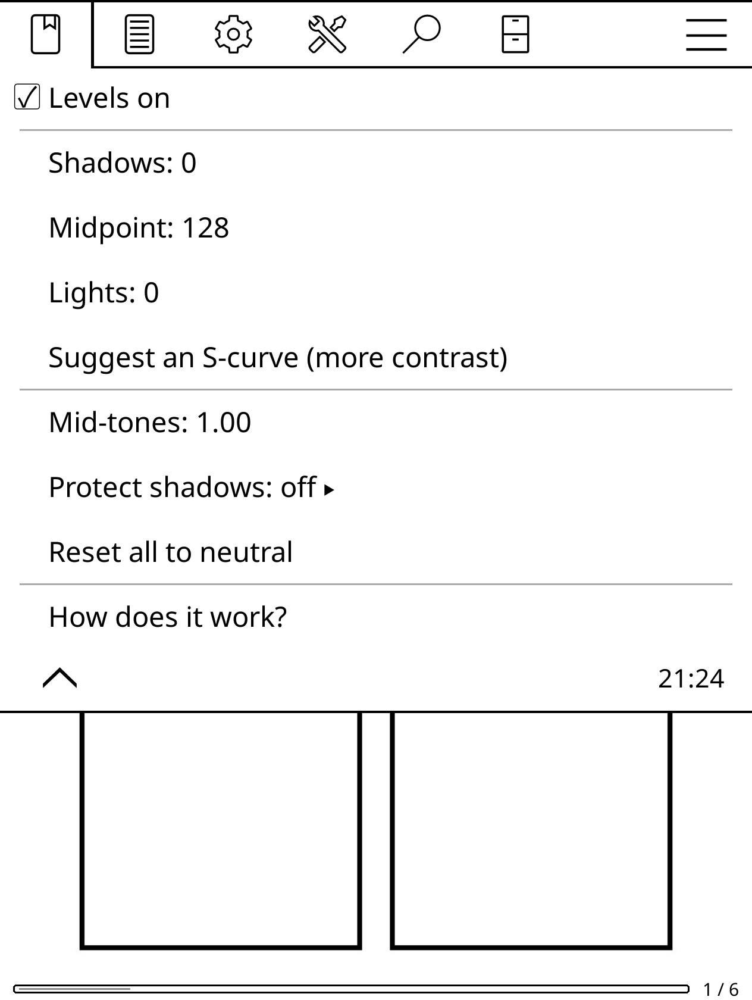

# Levels (Tonwerte) for KOReader

*Deutsch: [README.de.md](README.de.md)*

A KOReader plugin with your own tone curve for comics, like in an image editor. Black stays black, white stays white. In between you can move a midpoint and lighten or darken the shadows and the lights separately, for example for an S-curve with more contrast.

- It is meant for colour and greyscale comic pages. Both colour pages (RGB) and greyscale pages are handled.
- It doesn't change any KOReader files, so it survives updates.
- It works together with [Comic Panel Zoom](https://github.com/Akrota/koreader-comic-panel-zoom): the plugin keeps the page-rendering call in the form Panel Zoom expects.

**Status: prototype / beta.** It runs on a Kobo Libra Colour, but the settings are still being tuned.

## Screenshots

 

## Features

- **Midpoint** (30 to 225, default 128): splits shadows and lights. The midpoint itself keeps its brightness.
- **Shadows** (-100 to +100): lightens (above 0) or darkens (below 0) the tones between black and the midpoint.
- **Lights** (-100 to +100): lightens or darkens the tones between the midpoint and white.
- **Suggest an S-curve (more contrast):** one tap sets shadows -30, lights +30, midpoint 128.
- **Mid-tones** (0.5 to 1.6, default 1.0): lightens or darkens everything in between evenly (below 1.0 darker).
- **Protect shadows** (off / light / strong): the darkest tones don't block up.
- **On/off switch** and a **gesture** "Levels on/off" for a quick before/after comparison.
- **Reset all to neutral.**
- The settings apply to all comics alike (not per comic), so pages don't look different from each other.

## Installation

1. Download the ZIP from [Releases](../../releases) and unpack it, or download this repository.
2. Copy the folder **`tonwerte.koplugin`** to KOReader's `plugins` folder. On a Kobo, that is `.adds/koreader/plugins/`.
3. Restart KOReader.

## Settings

Open a comic, then go to: top menu → tools icon (wrench) → **Levels** (in a German KOReader: **Tonwerte**).

- **Levels on** (main switch; off = pages as without the plugin, the values are kept)
- **Shadows**
- **Midpoint**
- **Lights**
- **Suggest an S-curve (more contrast)**
- **Mid-tones**
- **Protect shadows** (off, light, strong)
- **Reset all to neutral**
- **How does it work?** (short explanation)

Long-press an entry for its help text. For the gesture: Settings → Taps and gestures → Gesture manager → "Levels on/off".

KOReader's own sliders (for example contrast) apply first, so it is best to leave KOReader's contrast at 1.0.

## How it works

All settings are combined into **one lookup table** with 256 entries (one per brightness value). Each freshly drawn page is run through this table once, colour channel by colour channel. That is fast: there is no per-pixel calculation, only a lookup. Order: curve (midpoint, shadows, lights), then mid-tones, then protect shadows.

If a page ever takes unusually long (more than 3 seconds), the plugin resets LuaJIT's compiler and writes a note to the log. The time of each page is logged as "Tonwerte: page ... s".

## Known limitation

If only one side is bent (for example only the shadows), the curve has a slight kink at the midpoint. With soft gradients it may be visible; with a symmetrical S-curve it is not. A smoother transition is possible if it turns out to matter.

## Tested on

Kobo Libra Colour with KOReader 2026.07.1 and ZenOS.

## Who made this

The code was written entirely by **Claude**, an AI by Anthropic (in Claude Code). The owner of this repository came up with the idea, tested the plugin on a Kobo and gave feedback, but did not write the code.

There is no warranty and no guaranteed support. Bug reports are welcome as [issues](../../issues). Please attach `crash.log` from the KOReader folder.

## License

[MIT](LICENSE)
